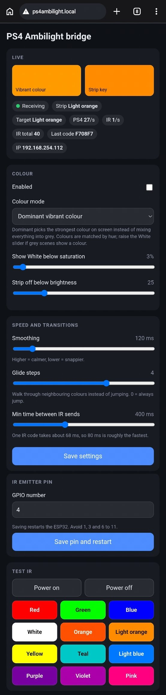

# PS4 Ambilight IR Bridge

Use the [PS4-Ambilight](https://github.com/mitchshimy/PS4-Ambilight) plugin with a **cheap, normal RGB LED strip and its IR remote**, with no cutting, soldering or special LED strip.

> ## ✅ Status: tested and working
> Tested on my own PS4 (GoldHEN + the PS4-Ambilight plugin) with an ESP32, a ready-made IR emitter module on GPIO 4,
> and a plain 5V RGB strip with a 24-key IR remote. It worked, and in my opinion the result looked close to a
> much more expensive addressable strip.
>
> Only the **default web page settings** were tested. The other settings (colour mode, smoothing, glide steps,
> changing the pin from the web page) are implemented but **not tested yet**. Reports are welcome.

## Goal

The excellent PS4-Ambilight plugin needs a WLED controller and an addressable LED strip (WS2812B).
The goal of this project is to make it **usable with a normal, cheap LED strip** (plain RGB, IR remote) and **without
cutting, soldering or rewiring** it.

An ESP32 replaces WLED. It:

1. Pretends to be a WLED controller on your network (receives DDP packets on UDP 4048).
2. Finds the most vibrant colour on screen and smooths it.
3. "Presses" the closest colour button on the strip's own IR remote, using an IR emitter.

```
PS4 game -> PS4-Ambilight plugin --DDP over Wi-Fi--> ESP32 (this project)
                                                          | IR emitter
                                                          v
                                          strip's IR receiver / controller
```

## Web interface

The ESP32 hosts a small settings page (open `http://<ESP32 IP>` or `http://ps4ambilight.local`):

<p align="center"></p>

It shows the live colour, what is on the strip, PS4 frames per second and IR sends per second, lets you change the
colour and speed settings, change the IR pin, and test every colour key.

## Limitations (by design)

- The whole strip shows **one colour**, so it is mood lighting, not true per-edge ambilight.
- Only the remote's fixed colours (about 12 to 20) can be shown.
- One IR code takes about 68 ms, so the strip can change about 12 times per second at best. The bridge still reads the
  plugin's frames at their full rate (30 fps or more) and smooths between them. It only sends when the chosen key changes.
- Needs line of sight between the IR emitter and the strip's receiver (a few cm is fine).

## What you need

- PS4 with GoldHEN, with the PS4-Ambilight plugin and companion app installed
- ESP32 dev board
- IR emitter: a ready-made module (SIG, VCC, GND), or a 940 nm IR LED with a 100 Ω resistor
- An IR receiver module (VS1838B / TSOP38238), only to capture your remote's codes
- Jumper wires (no soldering)
- An RGB strip with a 24-key IR remote
- Arduino IDE with the **esp32 by Espressif** board package and the **IRremoteESP8266** library

## Setup

### 1. Capture your remote's codes (once)
1. Wire the IR receiver: OUT -> GPIO 14, VCC -> 3V3, GND -> GND.
2. Open the example **IRrecvDumpV2** (IRremoteESP8266), set `kRecvPin` to `14`, upload.
3. Open Serial Monitor at 115200 baud, press each remote button and note the codes.
4. Compare with [docs/ir-codes.md](docs/ir-codes.md). If they match, you don't need to edit anything. Otherwise edit
   the `keys[]` table and the `IR_ON` / `IR_OFF` codes in the sketch.

### 2. Wire the IR emitter
Default signal pin is **GPIO 4** (`DEFAULT_IR_PIN` at the top of the sketch). You can also change it on the web page
(the ESP32 restarts); a pin saved there overrides the value in the code.
- Ready-made emitter module: SIG -> the pin, VCC -> 3V3 (or 5V/VIN if the module supports it), GND -> GND.
- Bare IR LED: pin -> 100 Ω resistor -> LED anode (long leg), cathode (short leg) -> GND.

Point the emitter at the strip controller's IR receiver from 2 to 5 cm. A phone camera shows the emitter as a
purple flash when it sends.

### 3. Flash the firmware
1. Open `firmware/ps4_ambilight_ir_bridge/ps4_ambilight_ir_bridge.ino` in Arduino IDE.
2. Copy `config.example.h` to `config.h` (same folder) and enter your Wi-Fi name and password.
3. Select your ESP32 board and port, upload.
4. Open Serial Monitor (115200). It prints the ESP32's **IP address**.

The ESP32 must join your **home Wi-Fi**, the same network as the PS4. If it can't connect it starts a fallback hotspot
`PS4-Ambilight`, page at `192.168.4.1`. Tip: reserve the ESP32's IP in your router so it never changes.

If the upload fails with an esptool error, lower Tools -> Upload Speed to 460800 or 115200 and use a short, good USB cable.

### 4. Test from the web page
Open the page and press the **Test IR** buttons. The strip should change colour. Do this before involving the PS4.

### 5. Connect the PS4 plugin
1. In GoldHEN: Settings -> GoldHEN -> Plugin Settings -> enable the plugin loader.
2. Install the PS4-Ambilight companion app and plugin (see its README).
3. In the companion app, **Set up**:
   - WLED host: the ESP32's IP
   - Port: `4048`
   - LED counts: any small numbers (for example 4 per edge), the layout is ignored
   - Color order: `RGB`
4. Press **Test Strip**, then start a game.

## Tuning

All of these are on the web page and are saved on the ESP32:

- **Colour mode**: *Dominant vibrant colour* (default) picks the strongest colour on screen instead of averaging
  everything into grey. It suits strips that blend colour from separate red, green and blue segments.
- **Show White below saturation**: raise it if grey scenes show a colour, lower it if colourful scenes show White.
- **Smoothing**: higher is calmer, lower is snappier. 0 turns it off.
- **Glide steps**: when the target colour is within this many keys of the current one, it walks through the neighbouring
  colours instead of jumping. 0 = always jump.
- **Min time between IR sends**: 80 ms is about the limit. Raise it if the strip misses codes.
- The PS4 menu has almost no colour, so the strip staying on White there is expected. Try a game.
- Packets rise on the page but the strip never reacts: use the **Test IR** buttons. If those fail too, it is the IR link
  (pin, polarity, distance, aim), not the PS4.

## Future improvements

- [ ] **Reset to defaults** button on the web page
- [ ] Test and tune the untested settings (colour modes, smoothing, glide)
- [ ] Wi-Fi setup from the web page (no `config.h` editing)
- [ ] Over-the-air firmware updates
- [ ] Learn IR codes from the web page (no separate capture sketch), and support for 44-key remotes and other protocols
- [ ] Per-key colour calibration on the web page
- [ ] Use the remote's brightness keys to follow the scene brightness
- [ ] Option for active-low IR emitter modules
- [ ] Turn the strip off automatically when the PS4 stops sending
- [ ] Game and Movie presets
- [ ] Password for the web page

## Contributing

Contributions are welcome. See [CONTRIBUTING.md](CONTRIBUTING.md). Test reports for other remotes, strips and
PS4 setups are especially useful.

## Credits

This project stands on the work of others. It does not copy their code, but it would not exist without them:

- **[mitchshimy / PS4-Ambilight](https://github.com/mitchshimy/PS4-Ambilight)** (GPL-3.0): the PS4 plugin and
  companion app this bridge is built for. All the hard work of capturing the PS4 video output is theirs.
- **[GoldHEN](https://github.com/GoldHEN)** and its plugin SDK, which the plugin runs on.
- **[WLED](https://github.com/Aircoookie/WLED)**, whose network behaviour this bridge imitates.
- **DDP (Distributed Display Protocol)** by 3waylabs, the packet format used.
- **[IRremoteESP8266](https://github.com/crankyoldgit/IRremoteESP8266)** (LGPL-2.1), used for sending and capturing IR codes.
- **Arduino core for the ESP32** by Espressif.

This project is independent and **not affiliated with or endorsed by** any of the above.

## Disclaimer

Running plugins requires a jailbroken console, which may carry risks and may not be allowed in your region or by
Sony's terms. You are responsible for your own console. Software is provided as is, with no warranty. See [LICENSE](LICENSE) (MIT).
